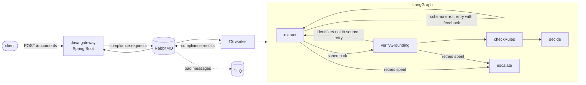

# LangGraph.js invoice compliance checker

A LangGraph workflow in TypeScript that reads supplier invoices, extracts structured data, checks it against EU invoicing rules and returns a verdict: `approved`, `rejected` or `needs_human_review`. A Spring Boot service integrates it into an application over RabbitMQ.

The point of the repo is the part that is hard in production: what happens when the model is wrong.



## How it works

1. **extract**: the model returns JSON. The graph treats that output as untrusted and validates it with a Zod schema.
2. **Repair loop**: if validation fails, the Zod issues go back to the model as instructions ("total: expected number, received string") and it tries again, up to 3 attempts.
3. **verifyGrounding**: identifiers that decide where money goes (invoice number, VAT ID, IBAN) must appear in the source document. A model that "fixes" a typo in an IBAN gets sent back, even if the invented IBAN passes the checksum.
4. **checkRules**: plain code, not the model, judges compliance: EU VAT ID format, IBAN mod-97 checksum, line amounts, subtotal, total, and payment terms over 60 days (EU Late Payment Directive), which go to a human rather than being rejected.
5. **decide / escalate**: errors mean `rejected`, warnings mean `needs_human_review`. If the model never produces valid, grounded output, or the model API fails, the document goes to a human. Model failures never become crashes.

**Idempotency**: the LangGraph thread ID is the document ID. A redelivered message returns the stored verdict instead of paying for a second model run that could disagree with the first.

**Messaging**: the worker uses `prefetch(1)`, publishes persistent results, and dead-letters messages it cannot parse. Both services declare the queues with the same dead-letter arguments.

## Evaluation

`npm run eval` runs the whole graph over labelled fixtures and scores decision accuracy and field accuracy. It fails below the thresholds, so CI blocks any prompt, model or rule change that makes results worse.

```
decision accuracy 100.0%  field accuracy 100.0%
```

That number comes from the offline extractor. Point the eval at a real model with `OPENAI_API_KEY` to measure the model.

## Run it

Without an API key, the worker uses `OfflineExtractor`, a deterministic parser for the fixture layout. Tests, evals and the demo all run offline. Set `OPENAI_API_KEY` (and optionally `OPENAI_MODEL`) to use a real model.

```bash
# workflow only
cd workflow && npm ci
npm test
npm run eval
npm run check -- fixtures/bad-iban.txt

# full stack: RabbitMQ + Java gateway + TS worker
docker compose up --build
curl -s -XPOST localhost:8080/documents -H 'content-type: application/json' \
  -d "$(jq -Rs '{text: .}' workflow/fixtures/long-terms.txt)"
curl -s localhost:8080/documents/<documentId>
```

## Layout

| Path | What |
|---|---|
| `workflow/src/graph.ts` | the LangGraph state, nodes and routing |
| `workflow/src/rules.ts` | deterministic compliance rules |
| `workflow/src/schema.ts` | Zod schema and message types |
| `workflow/src/extractors.ts` | OpenAI and offline extractors |
| `workflow/src/worker.ts` | RabbitMQ consumer |
| `workflow/src/eval.ts` | evaluation harness |
| `gateway/` | Spring Boot REST + AMQP integration |

## Deliberate shortcuts

- `MemorySaver` keeps graph checkpoints in process. With several workers, swap in a shared checkpointer (for example Postgres) so idempotency holds across them.
- The gateway stores verdicts in memory. A real product would store them next to the document.
- The rules cover format and arithmetic. Checking that a VAT ID is actually registered needs a VIES lookup, which is a natural next node.
